<h1 align="center">Hey, Dev! 👋</h1>

<h2 align="center">I'm Pardhu Sri Parupudi</h2>

   Learning AI/ML · Exploring Tech · Building as I Learn

  Passionate about exploring Artificial Intelligence, solving problems through code, and turning ideas into practical projects.

  Currently learning, experimenting with new technologies,
  strengthening my problem-solving skills, and exploring open-source contributions.

<h3 align="center">Connect & Explore</h3>

  
  
  

## Tech Stack

  

  
  
  

---

## GitHub Statistics

  
  

  

---
